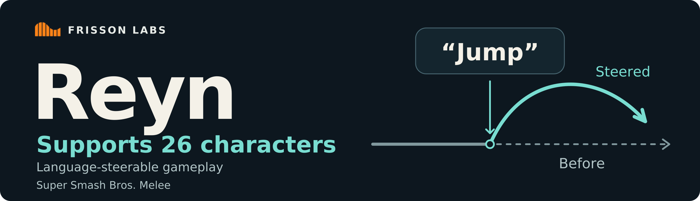
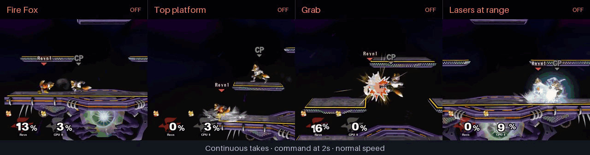
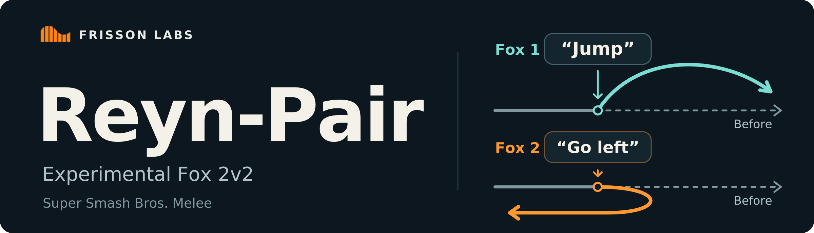
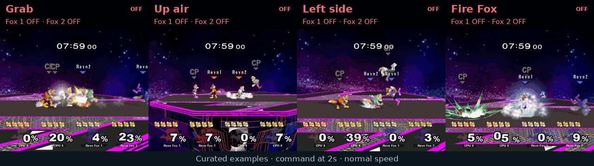
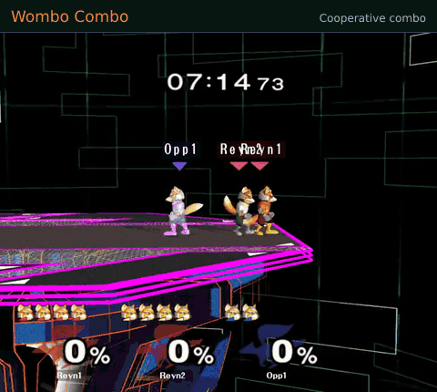

<p align="center">
  
</p>

<p align="center"><strong>Language-steerable agents for Melee.</strong><br />Steer play style, movement and combat across all 26 characters with natural-language instructions.</p>

<p align="center"><a href="#language-steering-in-action">Showcase</a> · <a href="#models">Models</a> · <a href="#quickstart">Quickstart</a> · <a href="#commands">Commands</a> · <a href="#language-steering">Language steering</a> · <a href="#reyn-pair">2v2</a> · <a href="#wombo-combo">Combos</a> · <a href="https://huggingface.co/collections/frisson-labs/reyn-6af5d6e9506dca3a131b13c3">Hugging Face</a></p>

> **Online play:** Please do not use these models in online matches without explicit permission from the other participants and the relevant platform or event organizers. Follow the platform's rules.

<p align="center"><strong>81.8% of test cases met their command-following target</strong><br />1,368 / 1,672 cases across the original-command and main special-move suites.</p>

## Language steering in action

Watch the orange Fox use Fire Fox, reach the top platform, grab and fire lasers from a distance. Each panel starts with **two seconds of unsteered play**. The bar turns green when the language instruction activates, with Reyn and the instruction labelled above Fox.

<p align="center">
<picture>
  <source type="image/webp" media="(max-width: 767px)" srcset="./assets/reyn-1v1-grid.webp" />
  
</picture>
</p>

*Each panel is a continuous clip from a separate game, shown at normal speed.*

## Models

| Model | Characters | Use |
| :--- | :--- | :--- |
| **[Reyn-26C](https://huggingface.co/frisson-labs/Reyn-26C)** | All 26 characters | Language steering |
| **[Reyn-Pair](https://huggingface.co/frisson-labs/Reyn-Pair)** | Two Fox teammates | Experimental 2v2 language steering |
| **[Wombo Combo](https://huggingface.co/frisson-labs/Wombo-Combo)** | Two Fox bots | Combos on a dummy opponent, made for fun |

Download the weights from Hugging Face and use the inference package here. Each model card describes its tests and input requirements.

## Quickstart

Use Python 3.12 and a PyTorch build that suits your device:

```bash
git clone https://github.com/frisson-labs/Reyn.git
cd Reyn
python -m pip install .
python -m pip install huggingface_hub
hf download frisson-labs/Reyn-26C \
  --local-dir model-files
```

The `hf` command comes from `huggingface_hub`. Keep the complete model download together:

```text
model-files/
  rein_policy.pt
  adapter.pt
  router.pt
  features_fallback.pt
  checksums.sha256
```

The loader checks these files before using them. PyTorch is the inference package's only dependency.

```python
from reyn import Reyn

model = Reyn.load(
    "model-files", character="peach"
)
inputs = model.example_input()
prediction = model.predict(
    inputs, phrase="pull a turnip"
)

print(prediction.action)
```

`example_input()` gives you synthetic tensors with the right field names, shapes and dtypes. Replace the values with your model inputs. The input is a nested tensor dictionary with batch size one. The prediction includes the action, categorical labels and logits. For GPU inference, pass `device="cuda"` when loading the model.

You can also run the tensor-only example as a script:

```bash
python example_inference.py \
  --model-dir model-files \
  --character peach \
  --phrase "pull a turnip"
```

## Commands

Use language steering to shape play style, movement and combat. Ask Reyn to use platforms, attack, defend or look for a combo.

| Category | Example instructions |
| :--- | :--- |
| Play style | `Be more aggressive.` · `Play defensive.` · `Play safe.` |
| Movement | `Jump from the ground.` · `Dash dance.` |
| Position | `Go to the left side.` · `Keep to the center of the stage.` |
| Platforms | `Go to the top platform.` · `Stay on the main floor.` |
| Attacks and grabs | `Use forward smash.` · `Attempt a grab.` |
| Defense | `Put your shield up.` · `Choose a spot dodge.` |
| Combos | `Do a three-hit combo.` · `Finish your combo with an up-air.` |
| Ledges and projectiles | `Take the ledge.` · `Keep your distance and shoot lasers.` |
| Character specials | `pull a turnip` · `fire fox` · `mario fireball` |

The **[full command reference](./docs/commands.md)** covers every supported command meaning, plus all 104 character-specific special moves and how to change or clear a command. Choose moves and destinations that fit the character and stage.

The [special-move CSV](./commands.csv) gives two example instructions per move and marks required character cues. The neural router reads the phrase as written; character and stage inputs do not rewrite it.

## Language steering

Once the router accepts a command, it stays active until you replace or clear it.

| Operation | Python |
| :--- | :--- |
| Send an instruction | `reply = model.say("Be more aggressive.")` |
| Predict again | `model.predict(inputs)` |
| Clear the command | `model.clear()` |
| Clear the command and history | `model.reset()` |

If `reply.outcome == "abstain"`, the previous command stays active. Use `model.clear()` to cancel directly. `predict(inputs, phrase=...)` can set the command and predict in one call.

`model.set_context("fox")` switches to Fox and clears the command and prediction history. It keeps the same weights loaded. `predict()` also reads the character from the input tensors. Each instance keeps its own history, and its weights stay fixed during inference.

## Reyn-Pair

<p align="center"></p>

**[Reyn-Pair](https://huggingface.co/frisson-labs/Reyn-Pair)** brings language steering to Fox 2v2 in Melee. Give each Fox its own instruction, send the same command to both, or leave either Fox unsteered.

This experimental, Fox-only release accepts 102 instructions covering movement, platforms, attacks, defense and team play. Commands can still miss or depend on the situation. See the [results and limits](./pair/docs/results.md) before choosing commands.

<p align="center">
<picture>
  <source type="image/webp" media="(max-width: 767px)" srcset="./pair/assets/reyn-2v2-grid.webp" />
  
</picture>
</p>

*Each panel shows two seconds of actual unsteered play, then the instruction and its response in the same continuous clip. The bar identifies the addressed Foxes. These selected examples do not measure overall success.*

Download `policy.pt`, `steering.pt`, `config.json` and `checksums.sha256` from the [model repository](https://huggingface.co/frisson-labs/Reyn-Pair/tree/main) into `pair-files/`. From this repository's root:

```bash
python -m pip install ./pair
python pair/example_inference.py pair-files --device cuda
```

```python
from reyn_doubles import Doubles

model = Doubles.load("pair-files", device="cuda", team=0)
world, views = model.example_input()  # Synthetic tensors for the input contract.

model.say("Attempt a grab.")  # Both Fox teammates.
prediction = model.predict(world, views)
actions = prediction.action  # [2, 13], in teammate port order.

model.say("Begin the Fire Fox move.", recipient="fox1")
model.say("Use up tilt.", recipient="fox2")  # Both commands stay active.
world.frame[...] += 1
prediction = model.predict(world, views)
model.clear()  # Both Foxes return to unsteered 2v2 play.
```

Instructions persist until replaced or cleared. Fox 1 is the lower-port teammate and Fox 2 is the higher-port teammate. The package accepts four-player state and model-input tensors and returns two predicted controller tensors.

The optional friendly-fire mask is off by default:

```python
model.set_friendly_fire_mask(True)
model.set_friendly_fire_mask(False)
```

It blocks attack inputs near a hittable teammate, while keeping movement, jumps and shields available. This proximity filter can still miss teammate hits; it does not change game rules. The showcase and existing results used it off.

See the [inference guide](./pair/README.md), [full command reference](./pair/docs/commands.md), and [tensor input contract](./pair/docs/inputs.md).

## Wombo Combo

[Wombo Combo](https://huggingface.co/frisson-labs/Wombo-Combo) is a Melee experiment we made for fun. Two Fox bots team up on a dummy opponent to see how far they can take a combo.

<p align="center">
<picture>
  <source type="image/webp" srcset="./assets/wombo-combo.webp" />
  
</picture>
</p>

*A highlight from the blog, shown at normal speed.*

The dummy is a Fox that doesn't fight back. This setup uses Final Destination, normal damage and friendly fire off. The two bots share weights and keep separate histories.

Download `base.pt`, `adapter.pt`, `config.json` and `feature_schema.json` from the Wombo Combo repository into `combo-files/`:

```python
from reyn import Combo

model = Combo.load("combo-files")
frames, features = model.example_input()
prediction = model.predict(frames, features)

print(prediction.action)
```

Each bot needs a base observation and 186 features about its partner and the combo's scoring state. Use the [exact input schema](./docs/combo-inputs.md) to replace the synthetic values. Outputs contain two actions, labels and per-component logits. Wombo Combo has its own base weights and adapter and takes no language phrase.

## License

Frisson Labs' inference code and model weights are released under the [MIT License](./LICENSE). See the [third-party notices](./THIRD_PARTY_NOTICES.md) for upstream attributions.

The online-play warning is guidance; the MIT license terms are unchanged.

---

From **Frisson Labs** · Related research: [Faynt](https://huggingface.co/collections/frisson-labs/faynt).
