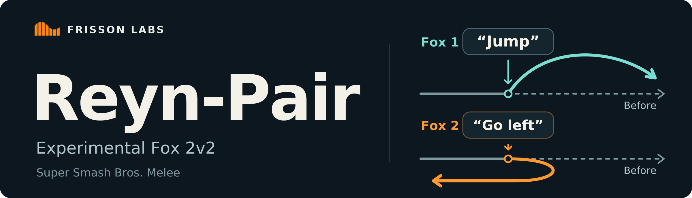
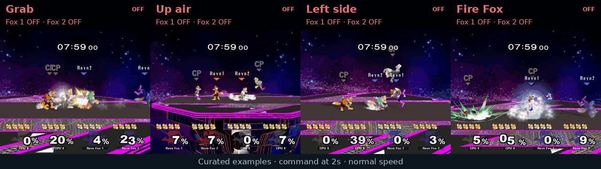

<p align="center"></p>

<p align="center"><a href="https://huggingface.co/frisson-labs/Reyn-Pair">Model weights</a> · <a href="docs/commands.md">Commands</a> · <a href="docs/inputs.md">Tensor inputs</a> · <a href="docs/results.md">Results and limits</a> · <a href="https://huggingface.co/collections/frisson-labs/reyn-6af5d6e9506dca3a131b13c3">Reyn collection</a> · <a href="https://www.frisson-labs.com/reyn">Blog</a></p>

**Reyn-Pair** is an experimental Fox 2v2 model for **Super Smash Bros. Melee**. Give each Fox its own instruction, send the same command to both, or leave either Fox unsteered.

> **Online play:** Please do not use these models in online matches without explicit permission from the other participants and the relevant platform or event organizers. Follow the platform's rules.

The command reference covers 102 available instructions, including platform movement, attack choices, defense and team play. This is an experimental release, and commands can still miss or depend on the situation.

<picture>
  <source media="(max-width: 767px)" srcset="assets/reyn-2v2-grid.webp">
  <source media="(min-width: 768px)" srcset="assets/reyn-2v2-strip.webp">
  
</picture>

Selected demonstrations show two seconds of actual unsteered play, followed by a language instruction and its response in the same continuous clip. The command bar identifies the addressed Foxes. These examples were selected for clarity and do not estimate overall success.

## Use the model

Download the files from the [model repository](https://huggingface.co/frisson-labs/Reyn-Pair/tree/main) into one directory. The loader requires `policy.pt`, `steering.pt`, `config.json`, and `checksums.sha256`.

From the repository root:

```bash
python -m pip install ./pair
python pair/example_inference.py /path/to/model --device cuda
```

```python
from reyn_doubles import Doubles

model = Doubles.load("/path/to/model", device="cuda", team=0)
world, views = model.example_input()  # Synthetic tensors for the input contract.

model.say("Attempt a grab.")  # Both Fox teammates.
prediction = model.predict(world, views)
actions = prediction.action  # [2, 13], in teammate port order.

model.say("Begin the Fire Fox move.", recipient="fox1")
model.say("Use up tilt.", recipient="fox2")  # Both commands stay active.
world.frame[...] += 1
prediction = model.predict(world, views)

model.clear()  # Both Foxes return to unsteered 2v2 play.
model.reset()  # Also clears every fighter/view history for a fresh sequence.
```

Instructions persist until replaced or cleared for that recipient. Fox 1 is the lower-port teammate and Fox 2 is the higher-port teammate. Team 0 uses ports 1 and 2; team 1 uses ports 3 and 4. The runtime rejects other roster layouts.

Use the exact phrases in the [command reference](docs/commands.md). The release uses their cached language representations and rejects unsupported phrases, so it does not claim unrestricted paraphrase or voice support.

The package accepts four-player state arrays and model-input tensors, and returns predicted controller tensors. It includes inference only. See [the input contract](docs/inputs.md) for view order, action fields, and history behavior.

## Friendly-fire mask

The optional mask is off by default. Turn it on or off without reloading the model:

```python
model.set_friendly_fire_mask(True)
model.set_friendly_fire_mask(False)
```

When enabled, it blocks attack inputs while a hittable teammate is within 30 game units. Movement, jumps and shields remain available. You can adjust the distance with `model.set_friendly_fire_mask(True, radius=24.0)`. The setting survives `reset()`.

This is a proximity filter. It does not predict hitboxes, stop attacks already in progress, or change the game's friendly-fire setting. Teammate hits are still possible. The results and showcase clips used the mask off.

## What to expect

Reyn-Pair is Fox-only and experimental. Throw and combo requests need the right opening, and platform instructions need a stage with the requested platform.

With language steering OFF, the model won 31/32 games against a Faynt Fox pair, 32/32 against released Reyn 1v1 Fox policies, and 31/32 against a SmashBot Fox pair. These tests used four Foxes on Final Destination, four stocks, friendly fire on, normal damage, and no added action delay. They measure fighting strength, not command following.

See the [command reference](docs/commands.md) for available instructions and the [results and limits](docs/results.md) for a short overview.

## License

Frisson Labs' inference code and model weights are released under the [MIT License](./LICENSE). See the [third-party notices](./THIRD_PARTY_NOTICES.md) for upstream attributions.

The online-play warning is guidance; the MIT license terms are unchanged.
